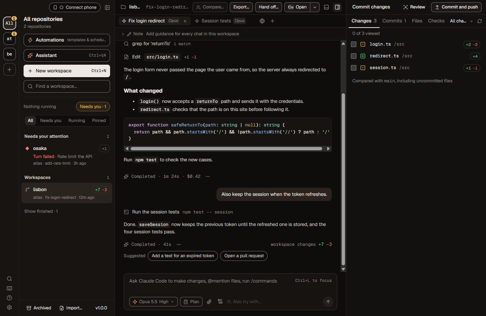
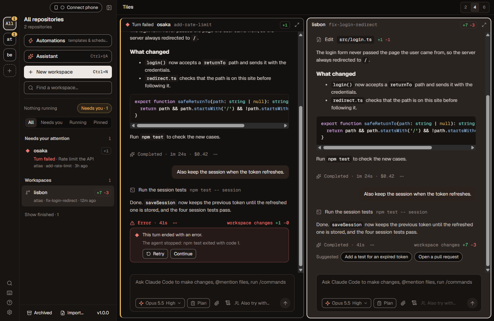
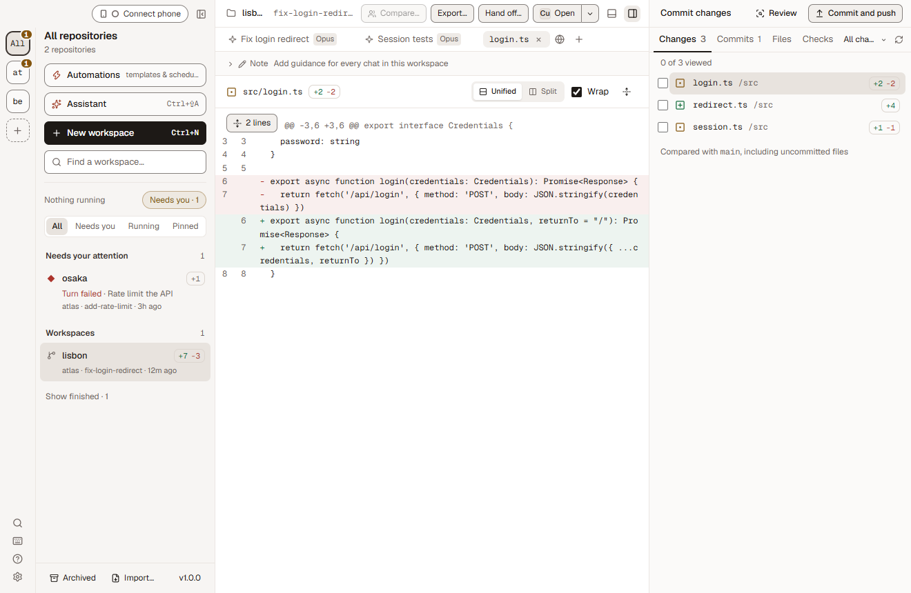
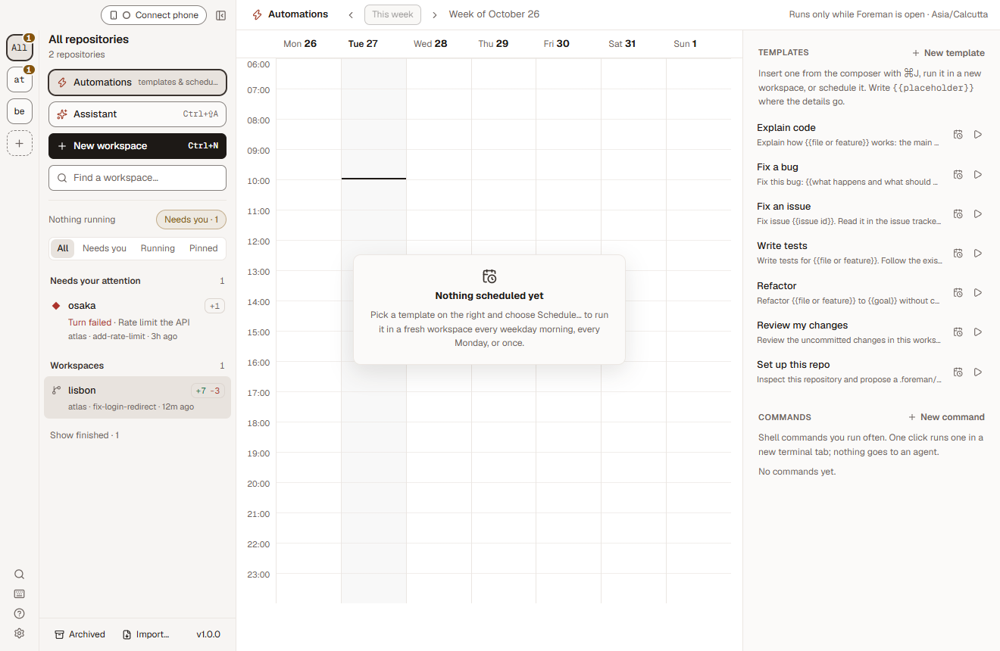

# Foreman

Run coding agents in parallel, each in its own git worktree on its own branch. Claude Code, Codex, Cursor, OpenCode and other ACP agents work side by side while you review their changes, answer their questions and open pull requests from one window.

Foreman runs on your computer. There is no Foreman account or cloud service: workspaces and app data stay local, and agents connect to their model providers with your own accounts or API keys. As an experiment, a workspace can also run in a remote sandbox on your own account (Vercel Sandbox, Docker, E2B or Daytona).



## A look around

**Tiles.** Watch several workspaces at once and step in where you're needed.



**Review.** Read every change as a diff before you commit, push or open a pull request.



**Automations.** Save prompts as templates, then run them on demand or on a schedule.



Foreman also has checkpoints you can rewind to, terminals and run scripts, a built-in assistant, the `foreman` command line, GitHub, Linear and Slack integrations, and a phone view for approving requests away from your desk. See the [guide](docs/guide.md) for those.

## Run it

Requirements:

- Node.js 22.12+ (22.x) or 24.x, with npm.
- Git on your PATH.
- A login or API key for at least one agent, set in **Settings → Agents**.
- For GitHub actions, the `gh` CLI with a login, or a token connection in **Settings → Integrations**.

```bash
npm install
npm run dev
```

Add a local Git repository, review its setup and run commands in repository settings, then create a workspace and send a prompt.

If `npm run dev` says Electron failed to install, run `node node_modules/electron/install.js`. Set `FOREMAN_DATA_DIR=/some/folder` to keep development state separate from an installed Foreman.

| Command | Does |
|---|---|
| `npm test` | Unit and integration tests |
| `npm run typecheck` | TypeScript check |
| `npm run build` / `npm start` | Build into `out/`, then preview the built app |
| `npm run dist:mac` / `npm run dist:win` | Build a DMG / NSIS installer into `dist/` |

Releases are described in [docs/maintenance.md](docs/maintenance.md#releases). After editing the SVGs in `build/icons/`, regenerate the icons with `npx electron scripts/render-icons.mjs` on macOS.

Foreman targets macOS and Windows, but has been verified on macOS only so far; see [Windows](docs/windows.md) for what still needs checking.

### Updates

An installed Foreman asks `api.github.com` whether a newer release of `elite-build/foreman` is out: a few seconds after each start, when your computer wakes, and every 4 hours (hourly or daily if you prefer). Each check is one unauthenticated request; GitHub sees your IP address and Foreman's version. When there is a new version, a card in the sidebar says so, with its release notes under **What's new**.

By default Foreman downloads the new version in the background and asks you to restart. **Restart** waits for running agents to finish first, holding new messages meanwhile; **Restart now** stops them, and they are listed for retry afterwards. You can also have it install whenever you quit, or only tell you. The Beta channel also offers prereleases. All of this is in **Settings → General → Updates**, where automatic checks can be turned off.

Foreman installs updates itself on Windows, and on macOS only when the app is signed with an Apple Developer ID: macOS won't let an ad-hoc signed copy, such as today's builds, replace itself. There, and when a release has no installers attached, the card links to the release page instead.

## Learn more

- [Guide](docs/guide.md): repository configuration, agent tools, integrations, backups, the command line and phone access
- [Command line reference](docs/cli.md)
- [Design system](docs/design-system.md), [accessibility](docs/accessibility.md) and [performance with many agents](docs/performance.md)
- [Contributing](CONTRIBUTING.md) and [AGENTS.md](AGENTS.md) for development conventions

## License

Foreman's original code is licensed under the [Apache License 2.0](LICENSE). See [NOTICE](NOTICE) for copyright and attribution. Third-party dependencies and separately identified material keep their own licenses, including the Wikipedia-derived [workspace names catalogue](docs/workspace-names.md); see [dependency licenses](docs/dependency-licenses.md).
