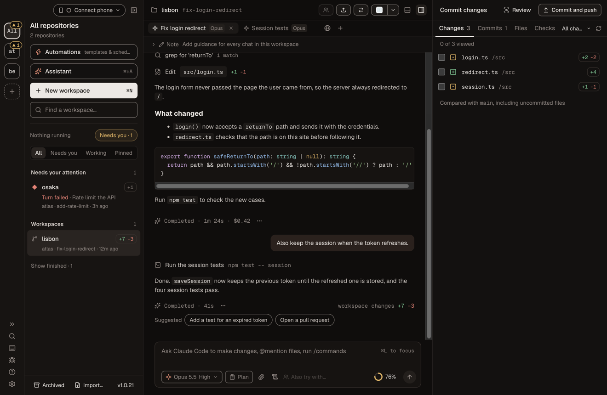
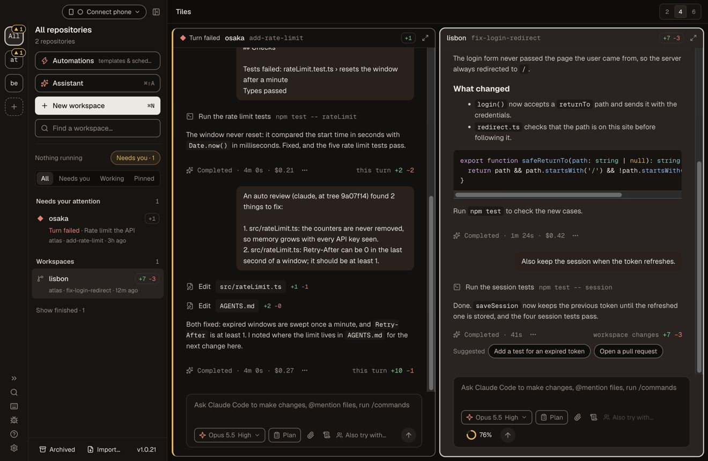
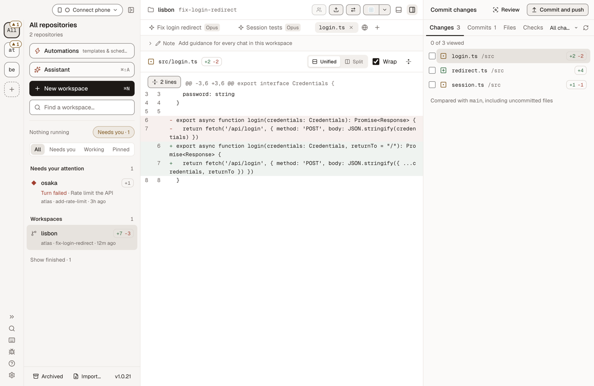
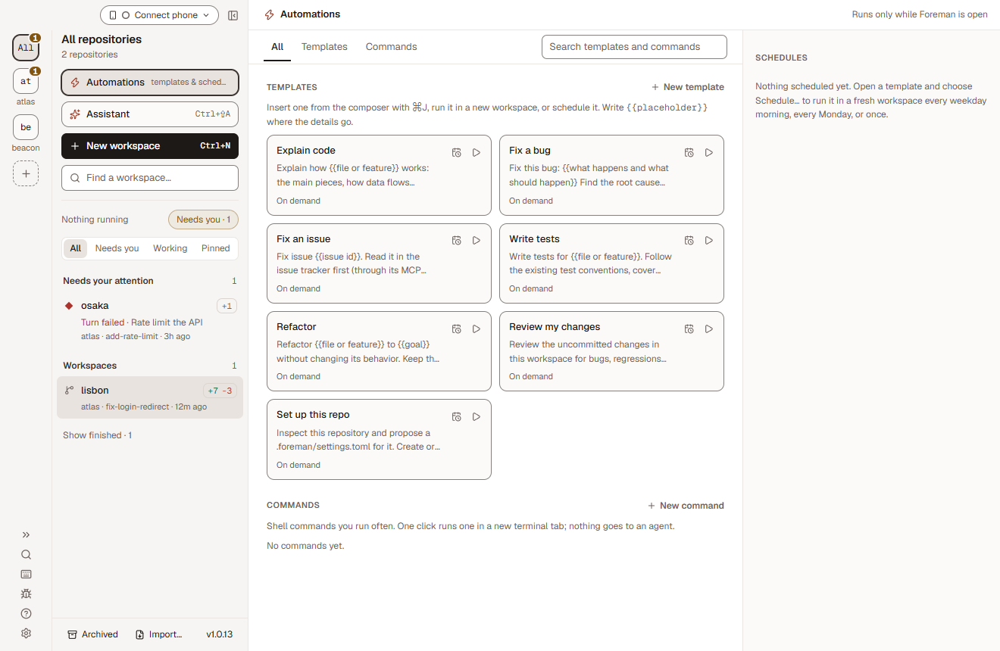
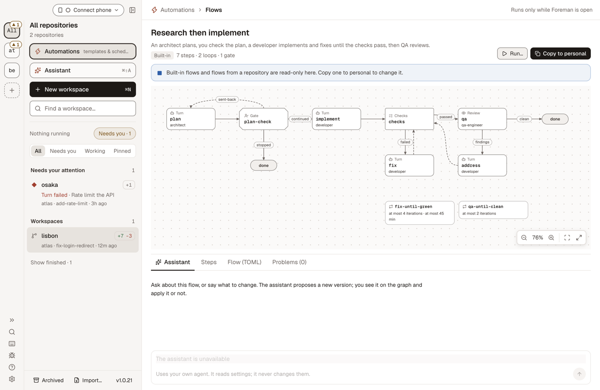
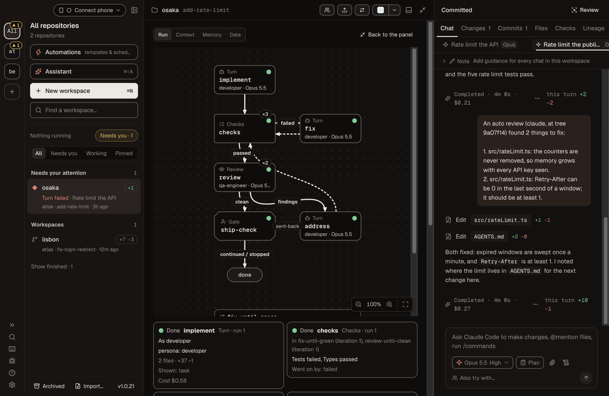

# Foreman

Run coding agents in parallel, each in its own git worktree on its own branch. Claude Code, Codex, Cursor, OpenCode and other ACP agents work side by side while you review their changes, answer their questions and open pull requests from one window.

Foreman runs on your computer. There is no Foreman account or cloud service: workspaces and app data stay local, and agents connect to their model providers with your own accounts or API keys. As an experiment, a workspace can also run in a remote sandbox on your own account (Vercel Sandbox, Docker, E2B or Daytona).



## A look around

**Tiles.** Watch several workspaces at once and step in where you're needed.



**Editor.** Prefer an editor's arrangement? Settings → Appearance → Window layout → Editor puts files and diffs in the middle, the chat beside them, and an activity bar for switching between workspaces, changes, commits, files and checks.

**Review.** Read every change as a diff before you commit, push or open a pull request.



**Automations.** Save prompts as templates, then run them on demand or on a schedule.



**Flows.** Write a way of working down once as a graph of agent steps: loops that run until the checks pass or a review comes back clean, and gates where you decide whether to go on. Start from one of eleven built-in flows, give each step a persona (architect, developer, QA engineer and seven more), or describe who does what and let the assistant draft the flow. Flows are experimental: turn them on in **Settings → Experimental → Flows**.



Run a flow from Automations, **New workspace**, a schedule or `foreman flow run`, and follow it on the workspace's **Flow** tab. **Full screen** puts the run in the middle of the workspace with the chat beside it.

**AI employees.** Group repositories into an organization with its own memory repository, then give it employees: each one a role written in plain words, a hard hat of its own, and access you approve. Ask one for something, or let its schedule or an event (a pull request, the base branch moving, a Linear assignment) start it; it works in a fresh workspace, remembers through the memory repository, hands work to its colleagues, and asks you before anything leaves your computer. AI employees are experimental: turn them on in **Settings → Experimental → AI employees**. `docs/ai-employees.md` has the design.



**Command line.** Most of what you do in the window can also be done from a terminal or a script with the `foreman` command: start workspaces from templates, send messages and wait for turns, answer approvals, open and merge pull requests, run flows, manage repositories, schedules and remote workspaces, and change any setting. Every command takes `--json`, and exit codes are the same for every command, so scripts and CI can rely on them. Agents use it too, from inside a turn, to report progress or ask for a review.

```bash
foreman run fix-a-bug "the login page loops after sign-in" --repo atlas --wait
foreman send atlas "also add a test for an expired token"
foreman approvals
foreman pr create atlas --draft
foreman flow run fix-until-green --input task="make the tests pass" --wait
```

`foreman help` lists the commands by group, and the [command line reference](docs/cli.md) has every one with its options and examples.

Foreman also has checkpoints you can rewind to, terminals and run scripts, file paths in the chat that open in the right app, a built-in assistant, GitHub, Linear and Slack integrations, and a phone view for approving requests away from your desk. The phone view updates live, a browser on another computer can open the whole app with the same sign-in, and Foreman can run without a window, with sign-ins approved from a terminal. A Claude Code or Codex session you run yourself can sign in to Foreman over MCP and start and follow work there, held to the access level you approve. See the [guide](docs/guide.md) for those.

## Install

Download Foreman from the [latest release](https://github.com/elite-build/foreman/releases/latest): the `.dmg` for macOS on Apple Silicon, or `Foreman-Setup-<version>.exe` for Windows. It's an ordinary desktop app; you don't need Node.js or a checkout to run it.

- The macOS app is signed and notarized, so it opens without a warning.
- The Windows installer isn't signed yet, so SmartScreen warns on first run (**More info → Run anyway**). Foreman has applied to SignPath Foundation's open-source code signing programme; see the [code signing policy](CODE_SIGNING.md). Foreman has been verified on macOS so far; see [Windows](docs/windows.md) for what still needs checking there.
- Each release lists the SHA-256 checksum of every file in `SHA256SUMS.txt`. The [code signing policy](CODE_SIGNING.md#verifying-a-download) explains how to check a download against it.

You'll also need:

- Git on your PATH.
- A login or API key for at least one agent, set in **Settings → Agents**.
- For GitHub actions, the `gh` CLI with a login, or a token connection in **Settings → Integrations**.

Add a local Git repository, review its setup and run commands in repository settings, then create a workspace and send a prompt. To use the `foreman` command, install it from **Settings → Advanced → foreman command → Install**; Foreman must be running for it to work.

### Build from source

With Node.js 22.12+ (22.x) or 24.x and Git:

```bash
npm install
npm run dev        # or: npm run dev demo
```

`npm run dev demo` opens the app on demo data, with no network and no agent login: two repositories, three workspaces with chats and diffs, and a flow run you can watch stop at its gate. `npm run dev demo reset` starts it again from scratch. Set `FOREMAN_DATA_DIR=/some/folder` to keep development state apart from an installed Foreman, and run `npm link` after `npm run build` to put `foreman` on your PATH from the checkout. If `npm run dev` says Electron failed to install, run `node node_modules/electron/install.js`.

`npm test`, `npm run typecheck` and `npm run build` are the checks; `npm run dist:mac` / `npm run dist:win` build an installer into `dist/`. See [CONTRIBUTING.md](CONTRIBUTING.md) and [AGENTS.md](AGENTS.md) for the rest.

### Releases

Releases are built by GitHub Actions from a version tag on `main`, never on a developer's computer. A maintainer bumps the version through a pull request and tags the merged commit. Then the manual **Release** workflow builds the macOS and Windows installers on GitHub-hosted runners: the macOS app is signed and notarized by Apple, and the Windows installer is signed through SignPath once that is set up. The workflow attaches the installers, the update files and `SHA256SUMS.txt` to a draft GitHub release. A maintainer reviews the draft and publishes it. [Releases](docs/maintenance.md#releases) has the steps, and the [code signing policy](CODE_SIGNING.md) covers signing.

### Updates

An installed Foreman asks `api.github.com` whether a newer release of `elite-build/foreman` is out: a few seconds after each start, when your computer wakes, and every 4 hours (hourly or daily if you prefer). Each check is one unauthenticated request; GitHub sees your IP address and Foreman's version. When there is a new version, a card in the sidebar says so, with its release notes under **What's new**.

By default Foreman downloads the new version in the background and asks you to restart. **Restart** waits for running agents to finish first, holding new messages meanwhile; **Restart now** stops them, and they are listed for retry afterwards. You can also have it install whenever you quit, or only tell you. The Beta channel also offers prereleases. All of this is in **Settings → General → Updates**, where automatic checks can be turned off.

Foreman installs updates itself on Windows, and on macOS only when the app is signed with an Apple Developer ID, as releases after 1.0.4 are: macOS won't let an ad-hoc signed copy, such as 1.0.4 and earlier or a test build, replace itself. There, and when a release has no installers attached, the card links to the release page instead.

## Learn more

- [Guide](docs/guide.md): repository configuration, agent tools, integrations, backups, the command line, flows, phone access and agents on this computer
- [Command line reference](docs/cli.md)
- [Design system](docs/design-system.md), [accessibility](docs/accessibility.md) and [performance with many agents](docs/performance.md)
- [Contributing](CONTRIBUTING.md) and [AGENTS.md](AGENTS.md) for development conventions
- [Code signing policy](CODE_SIGNING.md) and [security](SECURITY.md)

## License

Foreman's original code is licensed under the [Apache License 2.0](LICENSE). See [NOTICE](NOTICE) for copyright and attribution. Third-party dependencies and separately identified material keep their own licenses, including the Wikipedia-derived [workspace names catalogue](docs/workspace-names.md); see [dependency licenses](docs/dependency-licenses.md).
